## Monospace

我们日常写代码或者使用终端，用的都是等宽字体，即 [Monospaced Font](https://en.wikipedia.org/wiki/Monospaced_font)。比如在 https://www.programmingfonts.org/ 可以看到多种等宽字体。

等宽字体的字母并不像比例字体那样彼此挨着、宽窄随字形变化，而是每一个都被放进一格看不见的方框里，所有方框一样宽。它的来历，与其说是审美上的选择，不如说是机械上的限制。打字机的年代，每敲下一个键，字车就往前走固定的一格。机器分不清哪个字该宽、哪个字该窄。后来屏l幕从电传打字机和早期终端那里继承了这个习惯，当初的约束慢慢变成惯例，最后长成一种很特别的样子。

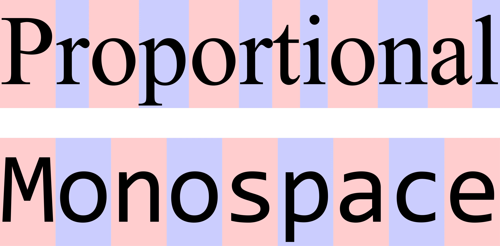

等宽字体看起来朴素、克制，甚至有点不修边幅。它是机器世界的视觉方言，属于源代码、终端、diff 工具和 ASCII 图形。在这种“不肯让任何一个字符多占一点地方”的固执背后，好像藏着某种更根本的东西。它真正关心的，远不只是排印。

## Pure Function

如果等宽字体是一种安排字符的方式，[函数式编程](https://en.wikipedia.org/wiki/Functional_programming)就是一种安排计算的方式。

它同样有一个很朴素的基本单元：纯函数。即同样的输入永远得到同样的输出，此外什么也不改，没有暗地里被改掉的状态，没有悄悄发生的副作用。程序于是被看成许多小函数的组合。`map`、`filter`、`reduce`、`compose` 把它们一层层接起来，拼成更大的结构，而每一块都可以单独看懂，也可以随时换掉。

为了守住这一点，函数式编程主动放下了命令式编程习以为常的许多便利：可以改来改去的变量，边走边改的流程，以及必须按特定次序执行的指令。它带着一点数学式的冷静和自律，长期以“难”和“优雅”并存出名，被一小群人奉为圭臬，也常被主流工程敬而远之。和等宽字体一样，这份克制背后也是一种原则：计算不该依赖那些看不见的东西。

## 同一种气质

一种字体，一种编程范式。一个管字符怎么排布，一个管计算怎么组织。看上去毫无关系，却常常被同一群人喜欢。这背后到底有什么共通之处？

把它们放在一起看久了，一条信念会慢慢清楚起来：系统里的每一个基本单元，都应当独立、平等、可预测、可组合；不该有隐而不见的上下文依赖，也不该有无法控制的副作用。等宽字体给每个字符同样的格子，函数式编程给每个纯函数同样的地位。没有哪个单元天生就比别的更重要。

这种信念，可以叫做“等权”。

等权算不上新词，也不是一套严密的理论。它更像一条暗线，贯穿在许多好系统的设计理念中。在字体里，它是等宽的网格；在代码里，它是纯函数和类型签名；在界面里，它是“同类事物同等对待”的克制；而在更大的人文世界里，它会在法治、市场、伦理和城市设计中再次出现。本文想沿着这条线，从一个个字符出发，慢慢走到一种关于秩序和公平的普遍想法。

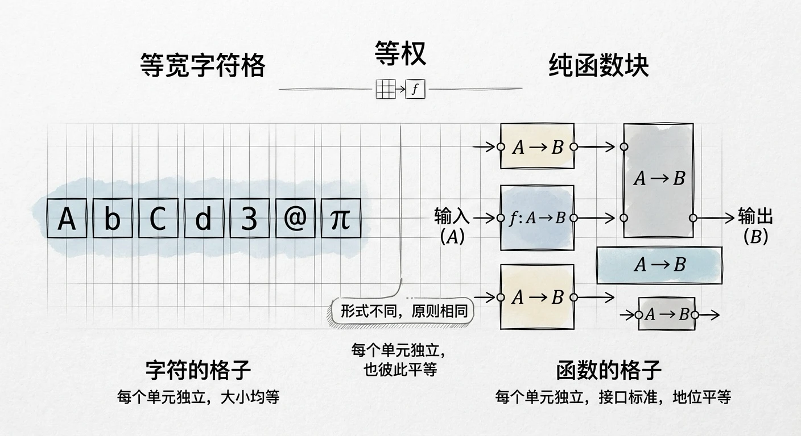

## 等宽：向不确定性宣战

等权这条暗线，最容易看见的源头还是等宽字体本身。要读懂它，不妨先问那个看起来有点笨的规则：为什么每个字符非要一样宽？

答案不在好看，而在确定。在等宽的世界里，你不必猜测一个符号到底有多宽，它的位置是确定的，也是可以预期的。终端、代码编辑器、diff 工具之所以离不开等宽字体，正是因为有了这种确定性，缩进、对齐、表格，乃至 ASCII 图形，才会符合预期。字符之间靠严格的间距规则组成更大的结构，而每一个单元又仍保持自己的独立和完整。

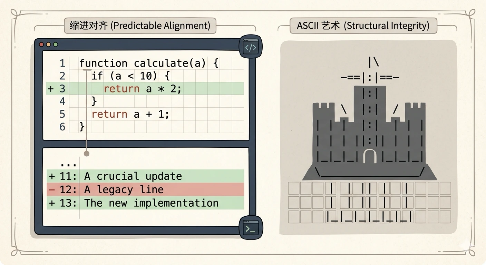

还值得一看的，是等宽字体对装饰的克制。它通常不追求衬线体的优雅曲线，也不特意表现无衬线体的现代感，而是功能优先，样子服从用途。更重要的是，一个字符长什么样，并不取决于它旁边是谁。无论一个字符出现在哪里，它的宽度都一样。这是一种“去上下文化”的取向：让每个单元独自成立，不因为环境而改变自己。

把这套逻辑抽出来看，等宽字体其实只做了一件事：把复杂压成均匀、可以组合的单元，用统一的规则，替换掉那些说不清的特权。

## 等权：系统里不该有贵族

如果把等权简单说成“系统里没有谁天生比谁更重要”，听起来像一句口号。可它一旦落到具体的系统里，就会变成一套相当严格的逻辑。

在比例字体里，W 天生比 i “大”，视觉上已经有了等级。宽的字符会挤占旁边的空间，窄的字符只好让路，这是一种不声不响的资源争夺。等宽字体拒绝这种等级：每个字符得到同样的空间配额，不管它本来是大是小，是繁是简。

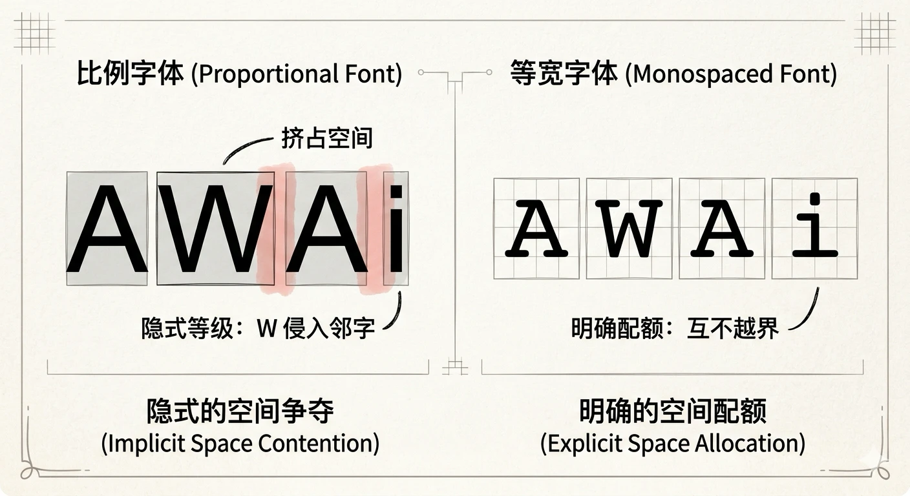

等权一旦成立，会带出几件很有意思的事：

1. 可替换。既然每个单元都遵守同样的规则，任何一个都可以被同类替换，整体结构也不会塌。你可以把任意字符放进任意位置，排版仍然成立。这也是等宽字体能成为工程工具基石的原因。
2. 去中心。每个字符都有固定的、互不侵犯的领地，资源争夺就消失了。没有谁需要讨好邻居，也没有谁能把空间独占。
3. 复杂度被摊开。在比例字体里，负担并不均匀：宽字符扛着更多的视觉重量，窄字符则搭一点便车。等宽字体把复杂度平均分到每一个字符上，没有谁偷懒，也没有谁过度承担。

不过，等权不是免费的。它会牺牲一点空间效率：i 其实不必那么宽，W 有时又显得局促。等宽字体用空间，换来了确定和可替换。这也说明，等权从来不是一种没有代价的理想，而是一笔清醒的交易和权衡：以局部的最优，换取整体的秩序。

## 类型的排版引擎

等宽字体处理的是视觉空间上的等权，函数式编程处理的则是计算逻辑上的“等宽化”。前面说的“去上下文化”，在这里对上了：一个字符的样子不依赖邻居，一个纯函数的行为也不依赖谁在调用它。函数式编程不愿引入继承层级、可变状态、命令式流程这些额外的复杂，正像等宽字体不愿依赖衬线和曲线来取胜。两边都是为了把复杂压到最少、最干净的原语上，让每个单元都能单独看懂，也能自由组合。

等权在这里走得更远。所有纯函数在地位上是平等的，没有谁天生就是主角。一个简单的 `add`，和一个复杂的 `parseJSON`，在类型系统看来都只是从 A 到 B 的映射，身份完全一样。命令式程序里，多个函数会争同一份可变状态，谁先运行、谁后运行，往往就决定了程序会怎样。不可变数据和纯函数把这场争夺解开了：每个函数只拥有自己的输入和输出，互不抢，也不互相干涉。

类型系统把这套逻辑推到了极致。它做的事情，和等宽排版几乎是同一件事：给每一个值划定一个同样规则下的格子。类型系统并不关心一个 `Int` 是 0 还是 999999，正如排版引擎不关心一个字符是 i 还是 W。它只问：你属于哪一格？一个函数运行时也许正在发网络请求、查数据库、做递归解析，内部可以非常复杂；可在类型看来，它不过是一个从 `IO String` 到 `IO Int` 的映射。里面那些曲折都被擦掉，只留下输入和输出。这是编译期的一次“等宽化”：把函数从具体行为收成一纸签名，让所有函数在类型这一层获得平等的地位。

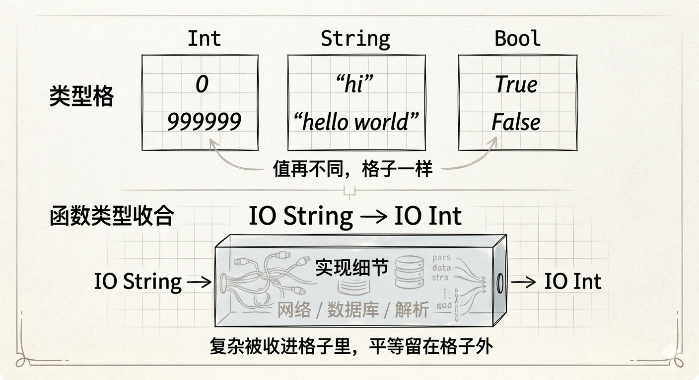

参数多态把等权表现得最彻底。恒等函数 `id :: a -> a` 对所有类型一视同仁；`map :: (a -> b) -> [a] -> [b]` 既不关心列表里装的是什么，也不关心传入的函数具体做什么。一个函数不必知道具体类型，也能工作。类型不再分成贵族和平民，而成了可以统一对待的平等成员。

类型类（type class）又加了一层：规则本身也可以普遍化。任何类型只要实现了 `Eq`，就获得“可以比较”的能力，不管它是 `Int`、`String`，还是你自己定义的 `Color`。这是一种契约上的平等：不要求大家长得一样，只要求遵守同一套接口。代数数据类型里的和类型也是如此。在 `data Shape = Circle Double | Rectangle Double Double` 中，圆和矩形地位相同；做模式匹配时，编译器会要求你把每个分支都处理到，不能只照顾 `Circle`，把 `Rectangle` 丢在一边。

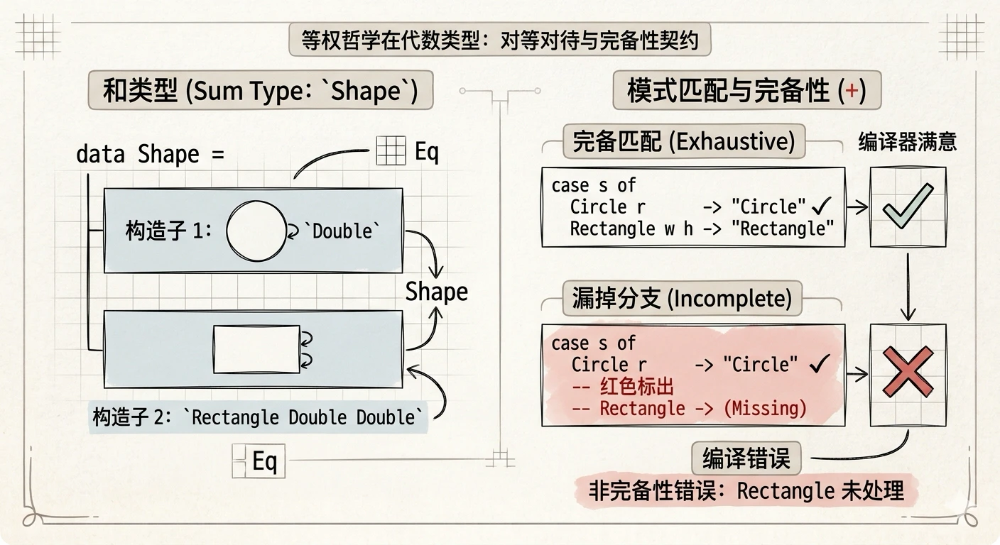

把这个类比说到头：等宽字体的排版引擎接收字符，按等宽规则排列，给出确定的版面；类型系统接收函数和值，按类型规则组合，给出可以推断的程序行为。两边都是靠统一的规则，让每个单元获得平等地位，也让整个系统变得可预测、可推理、可组合。类型系统，就是函数式编程世界里的等宽字体。

## 界面即公平

从字符到函数，等权处理的都是“物”和“物”的关系。等它走进产品设计，处理的就是人的感受了。

界面里的等权，不是让所有元素长得一样，而是先立下一规则：同类事物应当同等对待；差别必须来自功能，而不能来自视觉上的特权。它真正关心的是，用户能不能感到公平、有秩序、可以预期。

最常见的不平等，是视觉权力的失衡。一个按钮特别大、特别亮，就是在抢注意力；某张卡片颜色最突出，就是被系统暗示“更重要”；某类信息弱到几乎看不见，就是被判了“不重要”。好的视觉等权，并不是把所有按钮做成一样大，而是让视觉重量对得上功能重量：主操作可以更强，但不至于压过一切；次要操作应当弱一些，但不该被藏起来；同类信息用同样的样式，只有不同类别之间，才适合出现明显差别。

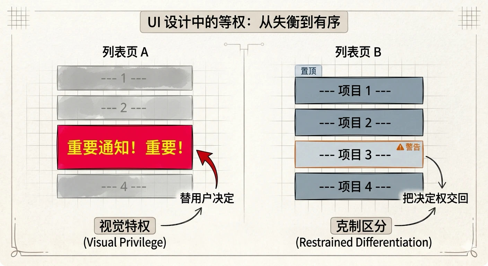

更深一层的不平等，藏在信息和交互里。系统不该偷偷替用户判断轻重。如果所有条目都是用户自己创建的内容，就不该让某一条因为商业原因长期占着最显眼的位置；如果所有通知属于同一级别，就不该把其中几条做得格外醒目。一旦系统为了转化、推荐或运营目标，悄悄改了信息的权重，用户迟早会感觉出来：我看见的，不是内容本身有多重要，而是系统希望我看见什么。界面也就不再可信。

交互上的不平等，常常表现为路径不对称。“订阅”很大，“取消订阅”却藏在第三层页面；“同意”高亮，“拒绝”发灰；“打开通知”很显眼，“关闭通知”很难找。按等权的看法，对称的动作应当有对称的路径：能方便地进来，也应能方便地离开；能方便地授权，也应能方便地收回；能方便地创建，也应能方便地删除。

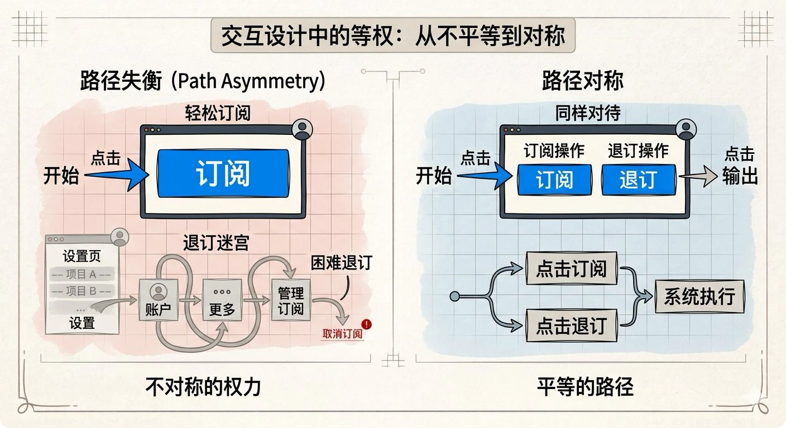

等权还应当照顾那些容易被忽略的角落。许多产品把力气都花在“成功路径”上，异常状态却很潦草：成功提示精致，错误提示粗暴；有内容时页面完整，没内容时像个半成品。这也是一种不平等：系统只尊重顺利发生的事情。真正等权的设计，会把空状态、错误状态、加载状态、部分成功，都当成正式体验的一部分。这和类型系统要求每个分支都必须被处理，是同一件事。

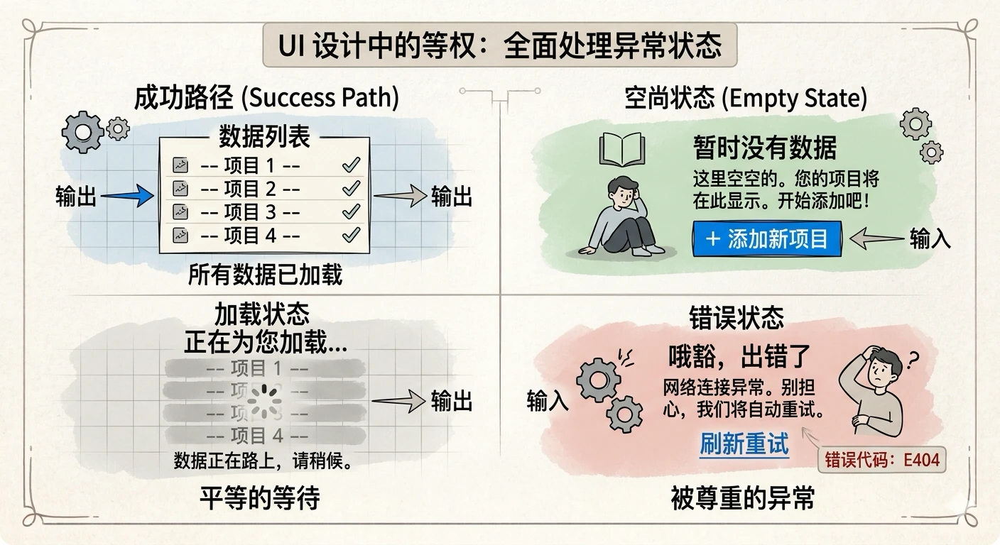

还需要说清楚：等权并不是平均主义。真正的问题从来不是差别本身，而是差别有没有理由。主按钮可以更大，因为它承担主要任务；付费功能可以不同，因为它提供额外价值；紧急通知可以更突出，因为它确实更紧急。可如果差别只是为了诱导点击、制造错觉、藏起退路、让人误判轻重，那就不是合理的差别，而是视觉和交互上的操控。每一处谁强谁弱、谁易谁难、谁先谁后，都应当说得出功能上的理由，而不该只是设计意图在暗中起作用。

## 产品的克制：臃肿与简洁

界面里的等权，落到一整个产品身上，还要面对一个更现实的变量：商业模式。真正决定一个产品模样的，常常不是设计理念，而是它靠什么盈利、向谁负责。

靠订阅、靠产品本身价值吸引人的软件，往往克制而干净，像等宽字体给每个功能同样的被使用机会。长期依赖“免费、广告再加增值”的软件，则容易把核心功能特权化，再把理财、直播、电商硬塞进来抢注意力，像排版里某些字符被突然放大加粗，把视觉上的平等破坏掉。臃肿通常不是技术问题，而是等权缺席之后的结果。好的软件不是功能最多的软件，而是让每个功能都有平等地位、也让用户保有平等选择权的软件。

## 规则的回声：等权在人文世界

如果觉得等权只是程序员的品味，那就过于狭隘了。这条暗线其实贯穿了许多人类自己造出来的系统：操作系统、法律、市场、城市、语言、道德。它们做的事情高度相似：用统一的规则拿掉那些说不清的特权，好让系统既能组合，也值得信任。

Unix 哲学，是等权落在操作系统里的样子。“一切皆文件”，把普通文件、目录、键盘、打印机、网络套接字都统一为文件描述符，让很不一样的东西走同一套接口。每个小工具只做一件事，再通过管道自由组合。`cat`、`grep`、`sort`、`wc` 地位平等，没有谁天生就是“主程序”。而纯文本作为通用接口，差不多就是 Unix 世界里的等宽字体：统一、平等、可以随便拼接的媒介。

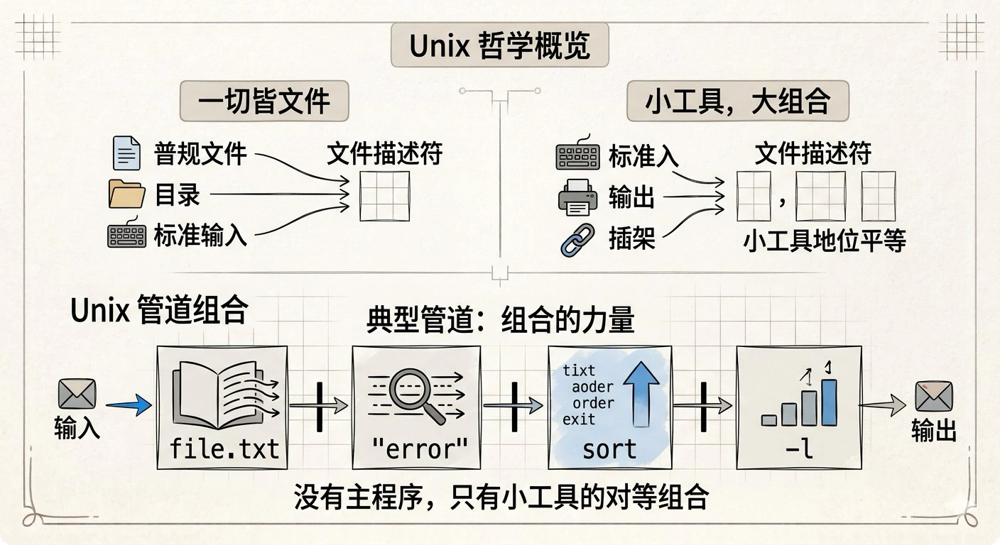

政治哲学里，美国哲学家约翰·罗尔斯在其《正义论》一书中提出过“无知之幕”：设计社会规则时，需要假设参与者被遮蔽了个人身份、阶级、能力等具体信息，以确保决策的公正性 。‌‌好的规则，应当在不知道具体身份的情况下依然成立。这和类型系统很像：规则要在不知道具体类型时也能成立。法治和人治的分别，也可以这样看。法治讲“法律面前人人平等”，很像制度层面的纯函数：同样的行为，应当得到同样的判决，不因身份、关系这些隐藏状态而改变。

经济学里，完全竞争市场中的买卖双方地位平等，没有谁能单方面定价。价格则像市场经济的类型签名，把千差万别的商品拉到同一个尺度上，才能比较，也才能交换。

法学里，程序正义的核心是“同样的程序适用于所有人”。编译器不会因为某个函数看起来很重要，就放过对它的检查；无罪推定则像法律上的初始值：判决之前，所有被告都站在同一个默认位置上。

语言学里也能听见类似的回声。索绪尔说，能指和所指的关系是约定的，每个符号在语言系统里地位平等。乔姆斯基认为，人类语言共享一套底层规则，不同的语言可以用不同的方式实现同一套接口。格莱斯的会话准则则要求说话的人平等对待听者的理解能力，不故意制造信息不对称。这些说法分属不同传统，指向的却是同一件事：意义可以不同，规则应当普遍。

建筑和城市就更具体了。砖的尺寸、网格系统，这类模数化设计，几乎就是物理世界里的等宽字体：每个模块占同样的空间，也可以自由组合。简·雅各布斯主张，好的街道应当让行人、自行车、汽车和店铺分享空间，而不是让某一种交通方式独占道路。坡道、盲道、语音提示这些无障碍设计，则让残障者和健全者获得同样可用的空间，是物理世界里的体验等权。

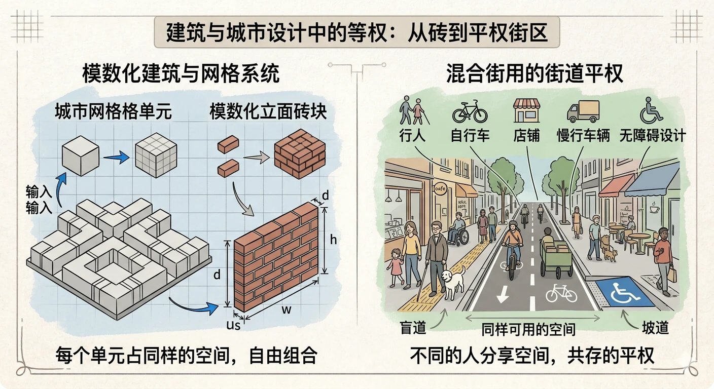

伦理学把这件事说到了更抽象的地方。康德的绝对命令要求：一条行为准则，应当能够成为普遍法则。好的规则，应对所有单元一视同仁。彼得·辛格谈“平等考虑”，主张一切有感知能力的生命都应当进入道德计算。边沁有一句更朴素的话：“每个人算一个，没有谁算多于一个”（Each to count for one, and none for more than one），算总的幸福时，每个人的权重相同。

连认知科学里也能看见相近的结构。工作记忆的“槽位”模型认为，人大约能同时处理四个左右的信息单元，每个槽位地位相当，和等宽格子隐隐对应。认知负荷理论则提醒：好的教学设计，应让每个步骤的负担大致均衡，而不是某些步骤过载、某些步骤空转。

这些领域的基本单元并不一样：字符、函数、公民、交易者、模块、道德主体。可它们都在回答同一个问题：怎样让系统里的每个单元，在统一规则下获得平等的地位？它们共同拒绝的，是隐而不见的特权；它们共同相信的是：秩序不来自等级，而来自规则前后一致。

## 大模型时代：等权的实践与危机

等权并没有停在纸面上。到了大模型的时代，它一边变成很具体的工程做法，一边也碰到了从未有过的压力。

先看实践的一面。一些极简的 Agent 架构，把“去掉特权”做得相当彻底：默认只提供读、写、改、执行四个核心工具，系统提示词不过两百来个 token，不预设哪种工具更重要，把组合的权利交还给模型和用户；也不绑定某一家大模型，让模型成为可以替换的资源。它甚至故意不内置子代理、计划模式和权限弹窗，因为它相信：Agent 真正容易失控的地方，常常不是模型不够强，而是运行框架替用户做了太多改不了的决定。这种极简的等权设计，反而在公开测试里，用远低于同类产品的成本，做出了更高的效率。

混合专家（MoE）架构里，也能看见类似的巧思。有的方法坚持等权重平均：一张图被切成十块还是一千块，它在优化目标里的权重都一样，正像等宽字体不管字符本来宽窄，都给相同的空间。有的则加入一个“零专家”，表示“这一次可以不算”。路由器自己决定哪些词元可以略过，等于承认每个词元都有被简化的权利。再往大处看，开源模型把一度被少数闭源系统垄断的能力摊开来，任何人都可以下载、微调、部署。技术平权的意思，是让从前只有专业开发者才握得住的能力，慢慢变成普通人也能使用的公共资源。

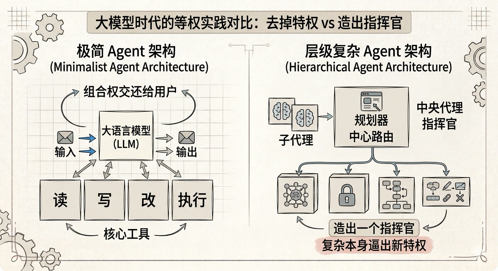

可是危机来得同样深，甚至更根本。

第一是复杂性特权。眼下的主流，是把 Agent 系统越做越厚：子代理、规划器、记忆模块、工具链、权限管理器一层层叠上去。这其实背离了 Unix 的精神。它正在造出新的“主程序”，一个握有调度权、判断权和优先级决定权的中央代理，从平等组合退回等级控制。复杂本身就是一种特权。系统越复杂，就越要回答“谁来指挥”；一旦有了指挥者，等权也就很难再成立。

第二是权力集中。开源一直在打破垄断，但顶级模型的训练成本已到数亿美元这一量级。谁更能烧得起算力和资本，谁就拥有更强的智能。这是很裸的资源特权。训练数据来自几乎所有人的公开内容，收益却集中在少数公司手里，很像一种数据上的封建。更不容易看见的，是规则制定权的转移。搜索引擎决定哪些信息更容易被看见，推荐算法决定哪些观点传得更远，AI 也就从工具变成了规则的制定者。到这里，等权不得不问：谁有权制定这些规则？按什么价值观制定？又由谁来监督？

第三是平权的幻觉。AI 平权常被说成“人人都能用”，可接得上并不等于用得好，起点相同也不等于结果相同。同样的技术，有人拿来提高做事的效率，有人只拿来写几句应景的话。真正能把它变成持续价值的，往往还是那些本来就有知识、资源和网络的人。马太效应在这个时代不但没有消失，反而加快了。技术并不会自动带来平权，它只有落到具体的制度里，才可能兑现承诺。等权要的不是“让每个人都能用上 AI”，而是“不让 AI 成为新的权力放大器”。

第四是认知上的特权。大模型本质上是非常强的概率统计器，擅长模仿，却未必真正理解。一旦这种统计智能被赋予决策权，算法就容易变成标准：它不再只是描述社会，而会通过资格认定和资源分配，反过来塑造社会。大模型又倾向于给出“最可能”的回答，少数派观点、边缘文化、非主流表达，便容易被系统地压下去。等权主张：不因为偏离标准，就失去被理解、被保障的资格。可眼下许多 AI 的设计逻辑正好相反，它把“偏离标准”看成噪声，而不是多样性。

## 结语：公平或许比强大更重要

从字符的等宽，到函数的平等，到类型的约束，再到界面对人的尊重、制度里的公正，等权这条暗线始终绕着同一件事转：用规则，替换等级。

它最后可以收成三句很朴素的话。等权的本质，是用前后一致的规则，替换那些说不清的等级。任何特权都应当被摊在明处，说得清，也站得住，而不是藏在偏好和习惯里。等权是一种取舍：放弃局部最好的那一种安排，换取整体上的秩序。等权也不是平均主义：它不拒绝差别，只要求每一处差别都来自真实需要，并且能用功能上的理由解释清楚。

当 AI 渐渐变成新的基础设施，一个很老的问题又被重新放到面前：不该用一种新的特权——算法的、资本的、认知的——去替换旧的特权。无论是一个字符、一个函数、一个用户，还是一种观点、一种文化，都应当在规则面前拥有同样的尊严。

好的系统不靠英雄，靠规则；不靠特权，靠前后一致；不靠局部最优，靠整体秩序。在一个越来越强大的时代，公平，也许比强大更重要。
