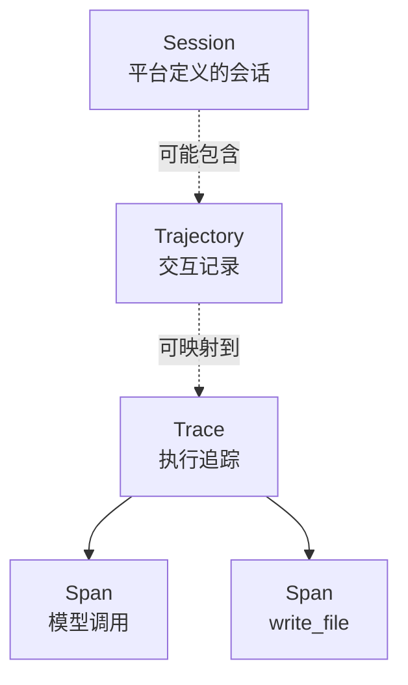

## 1. 轨迹：逐步追加的交互记录

本文所说的轨迹（trajectory），是按时间记录 Agent 与环境交互过程的数据。记录通常包括用户消息、Agent 回复、工具调用及其结果；是否包含推理内容，则取决于 Agent 和记录格式。

为了说明 Agent 循环，可以把模型调用时的上下文简化为两部分：

```text
上下文 = 静态前缀 + 轨迹
```

这里的“静态前缀”指系统指令、工具定义等相对稳定的信息；“轨迹”指随交互更新的历史。真实系统可能动态加入环境状态、检索结果，也可能压缩或改写历史，因此这只是一个便于理解的简化模型。模型根据当时可见的上下文生成回复或动作，运行循环再把新产生的交互记录下来。ReAct 是这类循环的一种常见描述方式。

工具调用可以看作 Agent 采取的动作，工具结果则是环境返回的观察。轨迹通常按时间记录这些事件。任务是否完成属于结果或评估信息；有些轨迹格式会额外记录它，但它不是轨迹概念本身的必要组成。

::: tip
系统提示词和工具定义不一定写入轨迹正文。Harness 可能在每次模型调用时把它们与历史一起组装成上下文。因此，轨迹文件中没有系统提示，并不能单独证明那次调用没有使用系统提示。
:::

## 2. ATIF：轨迹交换格式

许多 Agent 会将运行过程持久化为日志，但记录内容和字段由各自实现决定。例如，Cursor、Codex 和 Claude Code 的部分本地会话记录采用 JSONL；每行是一条 JSON 记录，字段和语义并不相同。查看器、评估脚本和训练管线若分别适配每种格式，接入新的 Agent 时就需要额外编写解析逻辑。

[ATIF](https://github.com/harbor-framework/harbor/blob/main/rfcs/0001-trajectory-format.md)（Agent Trajectory Interchange Format）是 Harbor 项目维护的 JSON 轨迹规范，目标是让不同工具能够按共同结构交换和处理 Agent 运行记录。该提案由 Boxuan Li 于 2025 年 10 月提出；链接所示规范版本为 ATIF-v1.8（2026 年 4 月）。主要字段包括：

- `schema_version`：这份文件遵循的 ATIF 版本，例如 `ATIF-v1.8`。
- `agent`：产生这条轨迹的 Agent 信息，包括名称、版本和可选的模型信息。
- `steps`：按顺序排列的交互步骤，从 1 开始编号。每步通过 `source` 标明来源，例如 `user`、`agent` 或 `system`。
- `tool_calls`：写在 `agent` 步骤上，记录这一步调用的工具和参数。
- `observation`：写在同一步上，记录这些调用的返回。
- `session_id`：可选。标识轨迹所属的运行或会话，具体使用方式由规范定义。
- `trajectory_id`：可选。标识轨迹对象；它与文件路径不是同一个概念。
- `final_metrics`：可选。整条轨迹的汇总指标，例如 token 用量和费用。
- `subagent_trajectories`：可选。嵌在同一文件中的子 Agent 轨迹。

ATIF 不会自动替换各个 Harness 的原生日志。它提供的是一种共同的数据结构：已有记录可以在采集时直接写成 ATIF，也可以在运行后转换，以便其他程序读取、比较或用于数据集。转换结果能保留多少信息，取决于原始记录是否包含这些信息。

## 3. 一次调用如何产生轨迹

下面用同一个任务，看这条历史是如何产生的：在仓库里创建 `hello.txt`，写入一行 `Hello`。

### 3.1 最小运行骨架

在这个简化示例中，模型根据上下文生成回复或工具调用；Harness 负责组装上下文并处理调用；环境执行文件操作并返回结果。实际系统的职责边界可能不同。下面的伪代码只展示成功路径的基本流程，不能直接运行，也不对应某个 SDK。

```text
history = [用户消息]

repeat:
    context = 静态前缀 + history
    response = Model(context)
    history.append(response)

    若 response 不含工具调用:
        结束，把 response 当作最终回复

    对每一个工具调用:
        observation = Environment.execute(Harness.validate(call))
        history.append(observation)
```

Harness 或其他日志组件可以在循环中记录模型回复和工具结果。日志是否同时保存模型看到的完整上下文，要看具体实现；不少格式只保存交互事件，或省略系统提示、内部推理等内容。记录工具结果有助于核对环境实际返回了什么；若只留下模型“准备写文件”的回复，就无法据此确认文件操作是否成功。

若需要分析任务为何结束，还应区分正常完成、用户中止、预算耗尽等结束原因。并非所有原生格式都会记录这些状态。

### 3.2 运行结束后，轨迹里有什么

一次成功创建 `hello.txt` 的交互，记录大致如下。这是简化后的数据形状，不代表所有 Agent 都使用相同的消息结构：

```text
[
  {
    role: "user",
    content: "在仓库里创建 hello.txt，写入 Hello"
  },

  # 第一次调用：模型决定写文件，此时还没有最终回复
  {
    role: "assistant",
    reasoning: "需要创建文件并写入指定内容",
    tool_calls: [
      {
        name: "write_file",
        args: { path: "hello.txt", content: "Hello" }
      }
    ]
  },

  # 框架执行工具，把观察追加进来
  {
    role: "tool",
    content: "wrote hello.txt"
  },

  # 第二次调用：模型看到观察之后，给出最终回复
  {
    role: "assistant",
    content: "已创建 hello.txt，内容为 Hello"
  }
]
```

整个过程两次调用模型，一次工具调用。第二次调用能够收尾，是因为它看见了 `wrote hello.txt`。若轨迹里只有模型的两段话，没有这条工具结果，读者无法知道文件是否真的落盘。

将这段交互映射为 ATIF 时，可以把用户消息记为 `step_id = 1`，把模型发出写文件调用及其观察记在 `step_id = 2`，再把最终回复记为 `step_id = 3`。ATIF 的约定是：底层能够识别单次模型推理边界时，通常按一次推理生成一个 agent step；同一步可以包含多个工具调用及其观察。实际转换仍应遵循所用规范版本和源数据边界。

### 3.3 Cursor 的会话文件

在本文检查的 Cursor 本地记录中，Agent 会话文件位于：

```text
~/.cursor/projects/<项目路径>/agent-transcripts/<会话 id>/<会话 id>.jsonl
```

这个路径中的项目目录名会将 `/` 替换为 `-`；示例环境中的子 Agent 记录位于同目录的 `subagents/` 下，各自保存为 jsonl。此类本地存储布局属于实现细节，可能随版本变化。

例如，输入“在仓库里创建 hello.txt，写入 Hello”后，截取到的会话记录如下：

```jsonl
{"role":"user","message":{"content":[{"type":"text","text":"<timestamp>Saturday, Oct 24, 2026, 5:32 PM (UTC+8)</timestamp>\n<user_query>\n在仓库里创建 hello.txt，写入 Hello\n</user_query>"}]}}
{"role":"assistant","message":{"content":[{"type":"text","text":"我来在仓库里创建 `hello.txt`，内容为 Hello。"},{"type":"tool_use","name":"Write","input":{"path":"/some-path/hello.txt","contents":"Hello\n"}}]}}
{"role":"assistant","message":{"content":[{"type":"text","text":"已在仓库根目录创建 `hello.txt`，内容为 `Hello`。"}]}}
{"type":"turn_ended","status":"success"}
```

在这个样例中，每行是一条 JSON 记录。用户消息和助手回复分别记录；助手回复中的 `content` 可以同时包含文本和 `tool_use`。因此第一条助手记录同时带有说明文字和 `Write` 调用，后续助手记录则是最终回复。如果中间还有读文件、修改等交互，也可能出现更多记录。样例末尾的 `turn_ended` 表示本轮结束；具体事件类型和字段应以对应版本的实现为准。

注意：

- 样例中的 `success` 是该条记录给出的状态，不能单凭它判断文件内容正确或任务通过验收。不同结束原因及其状态编码应以对应版本为准。
- 在这个样例中，工具调用写在助手记录的 `tool_use` 里，工具返回没有出现在该 jsonl 片段中。本文检查的环境可在编辑器状态库 `~/Library/Application Support/Cursor/User/globalStorage/state.vscdb` 中找到相关返回；部分较大的输出也可能另存到项目目录。存储位置和关联方式属于版本相关的实现细节。

### 3.4 Codex 的 rollout

本文检查的 Codex CLI 与编辑器环境将 rollout 文件按日期归档，路径形式如下：

```text
~/.codex/sessions/年/月/日/rollout-<时间>-<线程 id>.jsonl
```

部分 rollout 文件可能以 `.jsonl.zst` 压缩保存，可用 `zstd -dc` 查看。本文检查的 `~/.codex/session_index.jsonl` 包含线程 id、标题和更新时间等索引信息，运行记录则在 rollout 文件中。目录和索引格式可能随 Codex 版本及配置变化。

同一件“创建 `hello.txt`”的任务，Cursor 的样例文件只有几行，Codex rollout 则可能包含更多记录。差异不一定代表任务复杂度不同，也与各自的日志粒度、上下文记录和事件类型有关。

下面是一次 rollout 的简化示例。为便于阅读，省略了部分记录和字段；示例中的时间戳也未展示。它包含一次失败的仓库检查，随后才创建文件，因此不是最短成功路径。

```jsonl
{"ordinal":0,"type":"session_meta","payload":{"session_id":"01a16d49-57e9-76e3-9c36-eba93f13ce71","cwd":"/some-path","originator":"Codex Desktop","source":"vscode","base_instructions":{"text":"You are Codex, an agent based on GPT-6. ..."},"history_mode":"paginated"}}
{"ordinal":1,"type":"event_msg","payload":{"type":"task_started","turn_id":"01a16d49-5c40-77d3-99be-801afde92cc4","model_context_window":258400}}
{"ordinal":2,"type":"response_item","payload":{"type":"additional_tools","role":"developer","tools":[{"name":"functions","tools":[{"name":"exec"},{"name":"wait"},"..."]}]}}
{"ordinal":3,"type":"response_item","payload":{"type":"message","role":"developer","content":[{"type":"input_text","text":"You are Codex, an agent based on GPT-6. ..."}]}}
...
{"ordinal":15,"type":"response_item","payload":{"type":"message","role":"user","content":[{"type":"input_text","text":"在仓库里创建 hello.txt，写入 Hello\n"}]}}
{"ordinal":16,"type":"event_msg","payload":{"type":"item_completed","item":{"type":"UserMessage"}}}
{"ordinal":18,"type":"response_item","payload":{"type":"message","role":"assistant","phase":"commentary","content":[{"type":"output_text","text":"我先查看仓库状态和现有文件，确认 `hello.txt` 不会覆盖已有内容，然后创建它。"}]}}
{"ordinal":19,"type":"response_item","payload":{"type":"custom_tool_call","name":"exec","call_id":"call_d922bc47cf154e27b0168aaf1c71ddc6","input":"const r = await tools.exec_command({cmd:\"git status --short && rg --files -g 'hello.txt' -g '!node_modules'\",\"workdir\":\"/some-path\",\"max_output_tokens\":1000}); text(r.output)"}}
{"ordinal":21,"type":"event_msg","payload":{"type":"item_completed","item":{"type":"CommandExecution","status":"failed","exit_code":128,"aggregated_output":"fatal: not a git repository (or any of the parent directories): .git\n"}}}
{"ordinal":22,"type":"response_item","payload":{"type":"custom_tool_call_output","call_id":"call_d922bc47cf154e27b0168aaf1c71ddc6","output":[{"type":"input_text","text":"Script completed\nWall time 0.1 seconds\nOutput:\n"},{"type":"input_text","text":"fatal: not a git repository (or any of the parent directories): .git\n"}]}}
...
{"ordinal":32,"type":"response_item","payload":{"type":"reasoning","summary":[],"encrypted_content":"..."}}
{"ordinal":33,"type":"response_item","payload":{"type":"custom_tool_call","name":"exec","call_id":"call_ab9568402acc4c13997818e7cf0b17be","input":"const r = await tools.exec_command({cmd:\"python3 -c 'from pathlib import Path; p=Path(\"hello.txt\"); p.write_text(\"Hello\"); print(p.resolve())'\",\"workdir\":\"/some-path\",\"max_output_tokens\":1000}); text(r.output)"}}
{"ordinal":35,"type":"event_msg","payload":{"type":"item_completed","item":{"type":"CommandExecution","status":"completed","exit_code":0,"aggregated_output":"/some-path/hello.txt\n"}}}
{"ordinal":36,"type":"response_item","payload":{"type":"custom_tool_call_output","call_id":"call_ab9568402acc4c13997818e7cf0b17be","output":[{"type":"input_text","text":"Script completed\nWall time 0.1 seconds\nOutput:\n"},{"type":"input_text","text":"/some-path/hello.txt\n"}]}}
{"ordinal":39,"type":"response_item","payload":{"type":"message","role":"assistant","phase":"final_answer","content":[{"type":"output_text","text":"已在 [hello.txt](/some-path/hello.txt) 中写入 `Hello`。"}]}}
{"ordinal":42,"type":"event_msg","payload":{"type":"task_complete","last_agent_message":"已在 [hello.txt](/some-path/hello.txt) 中写入 `Hello`。","duration_ms":8520,"time_to_first_token_ms":2482}}
```

每一行是一条 JSON 记录，通常包含 `timestamp`、`ordinal`、`type` 等外层字段，具体字段因记录类型和版本而异；主体内容通常位于 `payload`。`session_meta`、developer 消息、`world_state` 和 `turn_context` 等可能提供指令或环境上下文。用户消息、助手回复、工具调用及结果则记录交互过程。并非每一行都对应一个对话步骤。

rollout 会同时包含内容记录和生命周期事件，但二者不是逐条对应的副本。例如，示例中的用户消息后面有一条 `item_completed` 事件；助手的 `commentary` 则以 `response_item` 记录。工具调用可记为 `custom_tool_call`，结果可能分别出现在执行事件和以相同 `call_id` 关联的 `custom_tool_call_output` 中。某些 `reasoning` 记录的正文保存在 `encrypted_content`，普通文本读取无法还原。

## 4. 轨迹与追踪：几个概念的边界

分析 Agent 运行时，常会遇到会话（session）、轨迹（trajectory）、追踪（trace）、操作跨度（span）几个概念。它们关注的对象不同：

- session 则是平台定义的一段会话，可能包含多轮交互
- 轨迹按时间记录 Agent 与环境的交互
- trace 组织追踪系统观测到的执行及其因果关系
- span 表示 trace 中的一段操作，例如一次模型调用或工具执行

这些概念之间没有通用的固定数量关系。依平台定义，一个 session 可能跨多轮对话；采集和导出方式也会影响一次运行对应多少条 trajectory 或 trace。导出器可以将轨迹映射到 trace，但这属于实现约定。轨迹的一步也不保证对应一个 span：一步可能包含多个工具调用，一个 span 也可能覆盖多个内部操作。



| 概念 | 常见关系 | 需要留意 |
| --- | --- | --- |
| session 与 trajectory | 由平台定义 | session 可能覆盖多轮交互 |
| trajectory 与 trace | 由采集和导出方式决定 | 可能一对一、一对多，或没有对应 trace |
| trace 与 span | 一棵 trace 通常由一个或多个 span 组成 | span 表示操作及其父子关系 |
| trajectory 的一步与 span | 没有固定映射 | 一步可能关联多个 span，span 也可能覆盖更细或更粗的操作 |

以创建 `hello.txt` 为例，轨迹可以记录用户请求、模型发出的写文件调用、工具结果和最终答复。若系统为模型调用和文件写入配置了埋点，trace 中可能分别出现相应 span，并用父子关系表示调用链。要比较轨迹和追踪数据，应先确认采集范围和映射规则。

## 5. 如何构造，构造之后用在哪里

构造轨迹常见有两种路径：运行时记录，或运行后转换。

运行时记录是在循环中逐步保存模型输出和工具结果。例如 Cursor 和 Codex 会写各自的原生格式；自建 Harness 也可以选择直接输出 ATIF。记录是否完整，取决于运行时实际采集的内容。

运行后转换是将已有的原生记录映射到统一结构。本文检查的 Cursor jsonl 样例没有包含工具返回；若对应版本将结果保存在其他位置，可依据调用标识尝试关联。Codex 的调用和结果也可能分散在多条记录中，可按 `call_id` 等标识重组。源数据缺失时应注明缺失，不能把推测补写成当时真实发生的观察。

构造或转换时，需要明确以下约定：

- **步骤边界**：ATIF 建议在能够识别单次推理边界时按一次 LLM 推理划分 agent step；一次输出可以包含多个工具调用。原生格式的行或事件边界未必等同于 ATIF 的 step，转换时应说明切分规则。
- **推理内容**：某些日志会记录推理摘要或受保护的数据。本文示例中的 Codex rollout `reasoning` 记录没有可读的摘要正文，内容位于 `encrypted_content`，普通文本读取无法还原。是否记录此类内容取决于实现和配置。
- **工具结果**：保留原文、摘要或截断内容都可以，但应注明处理方式。只留“命令执行成功”会丢失命令实际输出，影响复核。
- **子 Agent**：ATIF 支持在父轨迹中嵌入 `subagent_trajectories`；本文检查的 Cursor 记录将子 Agent 文件放在 `subagents/` 下。转换时应保留可识别的父子关系，并说明轨迹边界。
- **敏感信息**：在持久化或共享前，按数据处理要求移除密钥、凭证及不宜传播的本地信息。

轨迹结构稳定后，可以用于多种工作，但不同用途对数据完整性和标注的要求并不相同。

- **回看与调试**：按步骤检查模型决定、工具调用和环境结果，定位重复操作或缺失观察。原生会话查看器通常更适合日常排查。
- **恢复运行**：恢复能力取决于 Agent 是否支持加载相应格式。Codex 的 `resume` 使用自己的 rollout；Harbor 也将导出 ATIF 与从 ATIF 加载并启动会话作为不同能力。能导出 `trajectory.json`，不代表一定能从它恢复运行。
- **评估**：任务结果与执行过程应分别衡量。测试通过说明交付物满足了测试条件；步数、工具选择和失败后的恢复方式，则需要从过程记录中分析。只保存最终答复无法支持这类过程评估。
- **训练**：轨迹可用于构造监督微调或强化学习数据，但需按训练方法筛选、整理并补充必要标注。成功轨迹可作为示范；多条候选轨迹只有在具备偏好判断时，才适合用于偏好训练；带有奖励或结果标签的数据可供相应的强化学习流程使用。单有交互记录，并不足以自动成为高质量训练样本。
- **开销分析**：若轨迹包含 token、调用次数、重试和耗时等指标，可以据此分析成本与效率。用户请求很短，执行过程仍可能很长；重复步骤会增加时间和资源消耗。

## 6. 常见工具

按主要用途，可以把相关工具分为三类：查看原生日志、处理 ATIF，以及检索或观测运行过程。

- **原生日志查看**：Cursor 的 `agent-transcripts/*.jsonl` 和 Codex 的 `rollout-*.jsonl` 可以用文本编辑器或 `jq` 查看；压缩的 rollout 可用 `zstd -dc` 解压。Claude Code 也会在本机保存会话记录，但各产品的字段和语义不同，不能只凭 JSONL 扩展名就视为相同格式。具体路径和文件类型可能随版本改变。
- **ATIF 处理**：Harbor 项目维护 ATIF 规范及相关实现。Harbor 试验中的轨迹文件常见路径为 `agent/trajectory.json`；[python-atif](https://github.com/bolu61/python-atif) 可用于在 Python 中读写 ATIF。NVIDIA NeMo Agent Toolkit 也在推进 ATIF 相关支持，具体能力和字段兼容性应以所用版本文档为准。
- **会话检索与追踪观测**：[AgentsView](https://www.agentsview.io/) 用于索引和检索 Claude Code、Cursor、Codex 会话。LangSmith、Langfuse、Arize Phoenix 和 AgentOps 等平台可用于观测运行追踪；界面中的步骤视图如何生成，取决于各自的数据模型和集成方式。OpenTelemetry 的生成式 AI 语义约定描述 span 上的属性，不是 trajectory 文件格式。

一次运行可能同时留下原生日志和追踪数据，也可能只留下其中一种。需要跨工具交换或整理数据集时，可以将可用记录转换为 ATIF，并注明转换来源和缺失字段。

## 7. 小结

轨迹记录 Agent 与环境随时间发生的交互；模型调用时的上下文则由系统指令、工具信息和当时可见的历史等内容组成，具体取决于实现。ATIF 为轨迹提供一种可交换的 JSON 结构。Cursor 和 Codex 的原生日志各有格式与记录边界，转换时需要处理工具结果、事件关联和缺失数据。

trace 和 span 描述追踪系统观测到的执行过程，session 的范围由平台决定；它们与轨迹之间没有固定的一一对应关系。构造或转换轨迹时，应说明步骤划分、工具结果的保留方式、子 Agent 的组织方式和敏感数据处理规则。整理后的轨迹可用于回看、评估、训练数据构造和开销分析；能否恢复运行，则取决于 Agent 是否支持加载相应格式。
