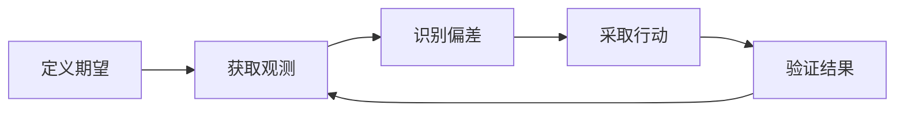

## 0. 前言

在我之前的某一份工作中，曾经做过运维系统，需要多对多个集群的数千个节点做日志和指标采集、监控以及告警。我们需要在节点上部署探针，采集机器的状态并上报到服务端，服务端做展示并判断节点的健康与否。

当时我的 leader 曾多次提及“观测与期望”，不过当时对于这些偏顶层设计的理解并不是很深刻，并且囿于系统的具体设计和实现，因此在一知半解中勉强做了一些实现。后来又工作多年，更深入地做过监控系统，也正在经历大模型的时代。很多东西回味起来，从设计哲学上来说，确实是有着一些统一的范式的。

## 1. 一个共同问题

在现代软件系统中，我们经常面对这样的问题：服务是否正常运行？业务流程是否按照预期推进？数据是否符合质量标准？AI Agent 是否真正完成了任务？安全策略是否得到了遵守？这些问题看起来分属不同的技术领域，却有一个共同点：我们必须知道系统实际上发生了什么，并将它与我们希望发生的事情进行比较。

在监控系统中，我们用指标和阈值判断服务是否异常；在工作流系统中，我们用流程定义和节点状态判断任务是否卡住；在软件测试中，我们用断言和预期输出判断程序是否正确；在 AI Agent 中，我们需要持续判断执行轨迹是否正在接近目标。

这些机制表面上各不相同，底层逻辑却高度相似。**一个系统需要被持续管理，前提是我们能够描述它的期望状态，并通过观测识别现实与期望之间的偏差。**

我们可以将这套机制简称为“观测与期望”，它并不是某一种具体技术，而是一种理解和构建复杂系统的通用视角。

## 2. 运行框架

一个完整的观测与期望机制，至少包含五个环节。

### 2.1 期望：定义系统应该如何运行

期望是判断系统行为是否合理的依据。

它可以是一项明确的数值指标，例如接口的错误率不能超过某个阈值；也可以是一项业务目标，例如订单必须在规定时间内完成；还可以是一组行为约束，例如 Agent 不得调用未授权工具，或者数据处理必须满足特定的数据契约。不同系统的期望可能完全不同，但它们都在回答同一个问题：**我们认为什么样的状态或行为是可以接受的？**

如果没有明确的期望，就很难定义异常，更无法区分系统是在正常运行，还是正在偏离目标。因此，建立可靠系统的第一步，不一定是增加监控，而是先定义什么才算正确。

### 2.2 观测：获取系统实际发生的信息

期望描述的是我们希望发生什么，观测描述的是实际发生了什么。

在传统基础设施中，观测通常来自指标、日志、链路追踪和事件；在业务系统中，它可能来自订单状态、审批记录和处理时长；在 AI Agent 中，它可能来自模型输出、工具调用、执行轨迹、环境反馈和任务结果。

然而，观测并不等于现实本身。我们看到的通常只是系统状态的一部分。某些状态无法直接测量，某些事件可能丢失，某些指标存在延迟，某些执行结果甚至可能具有误导性。因此，一个重要的问题不是系统是否产生了数据，而是这些数据是否足以支持我们对系统状态作出可靠判断。

### 2.3 比较：从数据中识别有意义的偏差

有了期望和观测，系统才有可能识别偏差。

但比较并不总是简单的数值相减。对于监控系统，偏差可能是错误率超出阈值；对于数据管道，偏差可能是数据分布突然发生变化；对于工作流，偏差可能是某个节点在规定时间内没有完成；对于 AI Agent，偏差可能是工具调用虽然成功，但执行结果并没有推进任务目标。

更重要的是，并非所有偏差都意味着异常。指标的短暂波动可能是正常现象，业务目标也可能因为外部环境变化而需要调整。真正有意义的偏差，需要结合时间、上下文、风险和业务目标来判断。

所以，比较的本质不是发现一切不同，而是识别那些值得关注、可能需要处理的不同。

### 2.4 行动：将判断转化为系统响应

发现偏差之后，系统还需要决定如何处理。

传统监控系统可能发送告警；自动化运维系统可能重启服务或扩容；数据平台可能隔离异常数据；工作流系统可能触发补偿操作；AI Agent 则可能重新规划、调用其他工具、请求用户澄清，或者停止执行。

从这个角度看，告警只是响应机制的一种，而不是观测体系的终点。不同偏差应当对应不同的处理策略。轻微波动可能只需要记录，持续异常可能需要告警，高风险行为则可能要求立即阻断。

**成熟的系统不只是知道哪里出了问题，还应当知道什么问题值得处理、应该采取什么行动，以及哪些行动不应被自动执行。**

### 2.5 验证：确认行动是否真正有效

行动之后，还需要重新观测。

服务重启不代表故障已经解决；数据重跑不代表数据质量已经恢复；Agent 再次调用工具不代表任务已经完成。如果系统只负责执行修复动作，却不验证最终结果，那么它只能证明自己采取了行动，不能证明问题已经消失。因此，完整的机制应当形成一个持续循环：

定义期望、获取观测、识别偏差、采取行动、验证结果，再进入下一轮判断。

这使系统不再只是被动地记录事件，而是具备持续感知和调整自身运行状态的能力。

## 3. 跨领域视角

监控系统和 AI Agent 看似不同，却都要依据实际状态与目标之间的差异作出响应。监控系统将指标与可靠性目标比较，触发告警或修复；Agent 则根据任务进度、工具结果和环境反馈，判断是继续执行、调整计划，还是停止并请求帮助。

Agent 的这一过程可以用 **ReAct（Reasoning and Acting）**来理解：模型交替进行推理与行动，并根据行动产生的观测决定下一步。这与“期望—观测—比较—行动—验证”的闭环理念一致。ReAct 描述推理、行动和反馈如何交替发生；观测与期望框架则强调目标、偏差判断、行动边界和结果验证。因此，Agent 的治理不能只看工具是否调用成功，还要看任务是否推进、结果是否正确、过程是否符合约束。**系统运行正常，不代表任务完成；任务完成，也不必然代表结果正确。**

同样的机制也存在于其他领域：

- 软件测试用断言比较实际与预期行为
- 数据治理用质量检查验证数据契约
- 安全系统依据访问策略处理登录和调用
- 分布式系统根据心跳与提交记录判断是否需要恢复
- 业务流程则按 SLA 和节点状态触发升级或补偿

这些例子共同说明，观测与期望是一种跨领域的架构视角：明确目标，观察状态，判断偏差，再选择适当的响应方式。

## 4. 定义有效期望

讨论可观测性时，人们往往把注意力放在采集更多指标、生成更多日志、建立更完整的调用链上。这些能力解决的是信息获取问题；更难的是决定观察什么，以及依据什么判断异常。

如果期望定义不合理，再完整的观测也可能制造大量无意义告警。CPU 使用率持续升高，不一定意味着用户体验变差；Agent 工具调用次数增加，也不一定说明任务失败。反过来，某些关键问题未必会及时表现为传统运行指标的异常。因此，观测体系应围绕有意义的目标建立，而不是只围绕容易采集的数据建立。

期望往往包含多个维度。服务要考虑可用性、延迟、错误率和成本；Agent 要考虑任务成功率、结果质量、执行时间、资源消耗和安全边界；数据平台则要考虑完整性、准确性、时效性和一致性。这些目标还可能相互冲突：更快的执行可能成本更高，更激进的自动修复可能带来更大风险。

所以，定义期望不只是设定技术阈值，也涉及业务目标、风险偏好和治理原则。期望应当足够明确，能够支持判断；也应保留必要的上下文，避免把局部指标误当成最终目标。

## 5. 形成闭环

不同系统的观测与响应能力，可以粗略分成三个层次：

- 可见：记录发生了什么，提供日志、指标和事件，由人来分析。
- 可判：判断是否存在偏差，借助规则、阈值、策略或异常检测进行告警和分类。
- 可控：根据判断采取行动，并通过后续观测确认行动是否有效。

不过，自动化程度越高并不等于系统越可靠。观测有误，系统可能针对错误状态行动；期望有误，系统可能高效地追求错误目标；纠偏策略缺少约束，自动化还可能放大故障。因此，闭环系统需要考虑行动的副作用、权限边界、幂等性、失败回退和人工接管。尤其在 Agent 场景中，模型能够自主决策，并不意味着所有操作都适合自动执行。可靠的自动化要求明确哪些动作可以自行完成、哪些必须经过授权，以及什么情况下应停止并交由人判断。

## 6. 认知边界

这套框架具有普适性，但不意味着系统可以完整掌握现实。

- 首先，观测总有边界。分布式系统存在信息延迟，复杂业务有隐藏依赖，Agent 也可能无法准确判断外部世界的真实情况。
- 其次，期望并非永远固定：业务环境、用户目标和运行条件会变化，系统有时需要重新评估目标，而不能只机械地消除偏差。
- 最后，偏差也未必能靠自动行动解决。有些问题需要补充信息，有些牵涉目标取舍，还有些必须由具有相应权限的人来判断。

成熟的机制应当承认这些边界：信息不足时表达不确定性，目标冲突时呈现取舍，风险过高时停止自动操作并请求介入。相比单纯追求更多指标、更快告警或更高自动化率，这种对认知和决策边界的处理更能支撑可靠运行。

## 7. 持续验证

从监控告警到 AI Agent，从软件测试到安全治理，我们反复面对同一个事实：描述系统应该如何运行，并不能保证现实会一直符合这份描述。系统会故障，数据会偏移，任务会跑偏，环境会变化，原本合理的策略也可能失效。

因此，可靠性不只来自设计阶段的正确性，也来自运行阶段持续验证和调整的能力。观测帮助我们理解现实，期望为判断提供依据，偏差识别使问题显现，行动机制让系统作出响应，反馈验证则确认响应是否有效。对于 Agent，ReAct 所体现的推理、行动与环境观测交替推进，也正说明了为什么行动必须持续接受反馈，并根据反馈修正。

**一个系统的成熟度，不仅取决于它能否按照设计运行，更取决于它能否发现偏离、理解偏离的意义，并在适当的边界内采取行动。**

随着软件从静态程序发展为分布式服务、自动化工作流和自主 Agent，我们构建的不再只是执行指令的程序，也是在变化环境中持续判断、响应和验证的系统。“观测与期望”提供了一种基础视角，帮助我们理解并设计这类系统。
