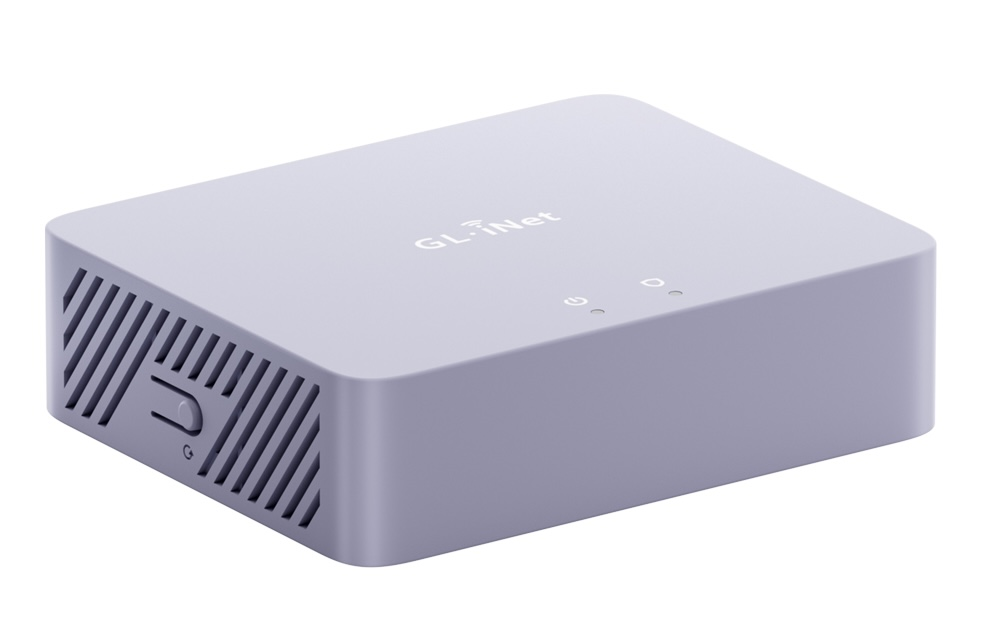
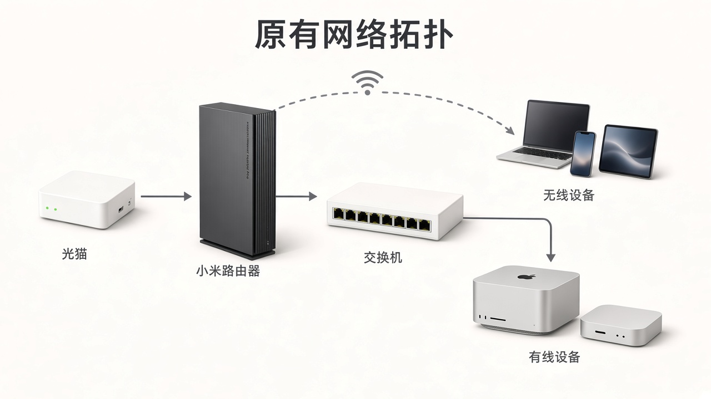
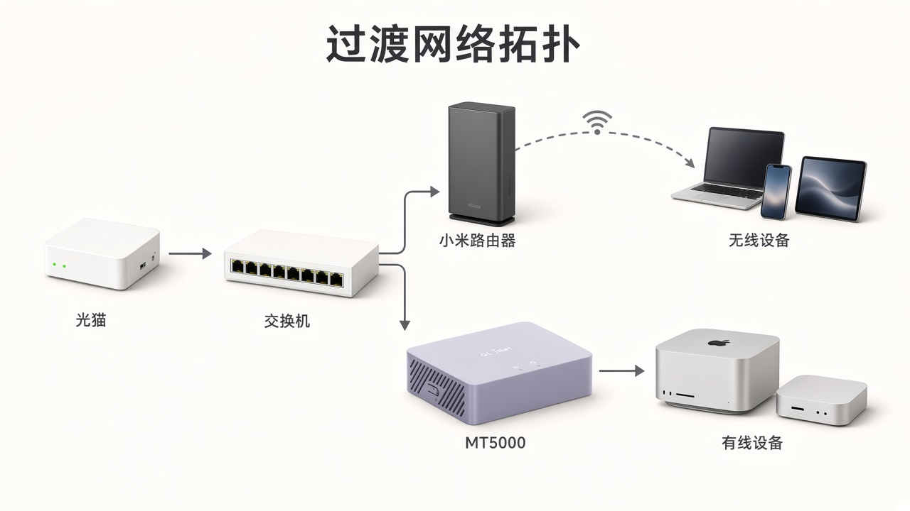
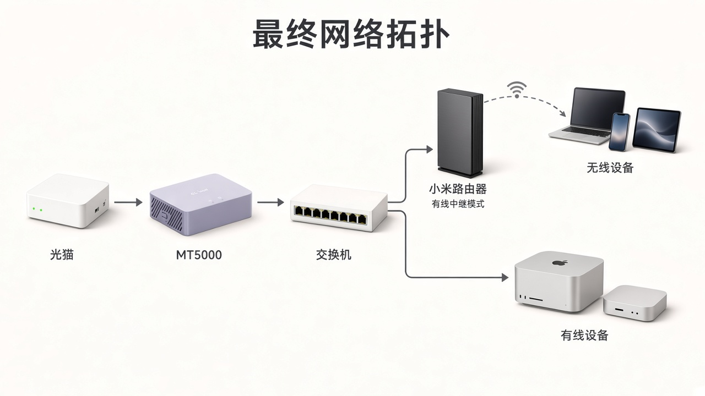

## 新设备

在之前的文章 [Homelab折腾总结](./2026-01-12-homelab.md) 中，使用的是小米 BE6500 Pro 作为主路由，内网 DNS 解析是额外在内网部署了一个 AdGuard Home，然后路由器的 DNS 指向 AdGuard Home。这样虽然也能跑，但是整体上不够优雅，如下需求无法满足：

- 小米路由器可定制性太差了，也无法 SSH 连接。希望路由器直接支持魔法，内网所有设备无感访问。
- 希望自定义 DNS 解析直接放在路由器里来做，这样服务器升级不影响网络，尽量减少设备间的互相依赖。

在最早折腾 Homelab 的时候，甚至还考虑过软路由的方案，最终也是觉得不够简单优雅而放弃。我理解组网的逻辑和软件开发是一致的，最好是“高内聚，低耦合”，这不仅仅是工程实践的范式，也是一个很好的管理模式。

所以最好的方案，还是直接用硬路由，且支持定制。考虑到家庭小规模网络的实际需求，以及已有设备等多种因素，最终选择了 GL.iNet MT5000.

::: tip 选择因素
1. 功能方面：支持定制。
2. 颜值方面：不喜欢外置天线，所以先排除了各种有外置天线的设备。
3. Wi-Fi 方面：由于小米路由器集成了中枢网关，家里一堆米家电器还离不开，所以正好可以作为 AP，因此无线不是刚需。
:::




## 网络拓扑迁移

有了新设备之后就要开始调整网络拓扑，为了在迁移过程中不影响已有的一些设备访问，因此通过如下方式调整。

原有网络拓扑为：



先调整为：



配置完成后，再调整为最终形态：



最终调整完成后因为 Wi-Fi 的 SSID 和密码不变，因此所有无线设备无需做任何网络配置，无缝切换。

## 安装 OpenClash

参考 [GL.iNet GL-MT5000 国内版：保留原厂固件实现 OpenClash + WireGuard + DDNS-GO](https://blog.fat.plus/archives/281)

安装依赖包：

```shell
# 安装
opkg --noaction install bash ruby ruby-yaml
opkg install bash ruby ruby-yaml

# 验证
bash --version | head -1
ruby --version
ruby -e 'require "yaml"; puts "yaml ok"'
```

安装 OpenClash 插件：

```shell
# 如果这里网络不通下载不了，可以先使用网络正常访问的设备下载，然后内网起一个 HTTP 服务传输
# 直接 scp 应该有依赖确实会报错
curl -L --retry 2 \
  https://github.com/vernesong/OpenClash/releases/download/v0.48.002/luci-app-openclash_0.48.002_all.ipk \
  -o /tmp/openclash.ipk

opkg --noaction install /tmp/openclash.ipk
opkg install /tmp/openclash.ipk

opkg status luci-app-openclash | grep -E '^(Package|Version|Status):'
ls -l /etc/init.d/openclash

rm -rf /tmp/luci-indexcache /tmp/luci-modulecache
/etc/init.d/uhttpd restart
```

然后重新登陆 LuCI，就可以看到“服务”菜单了。

## 打开隐藏菜单

::: tip
这里仅提供开启方法，可按需设置。我自己虽然开启了，但是并未实际使用这些功能。
:::

涉及到网络相关的一些功能菜单默认在中文模式下隐藏，通过如下脚本可以打开：

```shell

#!/bin/sh
set -eu

MENU_DIR="/usr/share/oui/menu.d"
BACKUP_DIR="/root/oui-menu-backup-$(date +%Y%m%d-%H%M%S)"

# 需要解除隐藏的菜单
MENUS="
adguardhome
dynamicdns
ovpnserver
torview
vpn-client
vpndashboard
wgserver
"

mkdir -p "$BACKUP_DIR"

for name in $MENUS; do
    file="$MENU_DIR/$name.json"

    if [ ! -f "$file" ]; then
        echo "[SKIP] $name: 文件不存在"
        continue
    fi

    # 备份原始文件
    cp -p "$file" "$BACKUP_DIR/$name.json"

    tmp="$(mktemp)"

    # 将单行或多行 lang_hide 数组替换为空数组
    awk '
    /"lang_hide"[[:space:]]*:/ {
        p = index($0, "[")
        q = index($0, "]")

        if (p > 0 && q > p) {
            print substr($0, 1, p-1) "[]" substr($0, q+1)
            next
        }

        if (p > 0) {
            prefix = substr($0, 1, p-1)
            skipping = 1
            next
        }
    }
    skipping {
        q = index($0, "]")
        if (q > 0) {
            print prefix "[]" substr($0, q+1)
            skipping = 0
        }
        next
    }
    { print }
    END {
        if (skipping) exit 1
    }
    ' "$file" > "$tmp"

    # 验证 JSON 格式
    if ! jsonfilter -i "$tmp" -e '@.view' >/dev/null 2>&1; then
        echo "[ERROR] $name: JSON 格式校验失败"
        rm -f "$tmp"
        exit 1
    fi

    # 覆盖原文件，保留原文件权限
    cat "$tmp" > "$file"
    rm -f "$tmp"

    echo "[OK] $name"
done

echo ""
echo "菜单隐藏限制修改完成！"
echo "备份目录：$BACKUP_DIR"
echo "无需重启服务，刷新 GL.iNet 管理页面即可。"
```

## 自定义域名

之前是通过内网服务器额外部署 AdGuard Home 来做的内网域名解析，现在直接进入 LuCI 页面，网络 → DHCP/DNS，地址添加配置即可，例如：

```
/myhomelab.com/192.168.8.2
```

此外，如果需要广告过滤等 DNS 拦截能力，也可以直接开启路由器自带的 AdGuard Home，无需再额外部署。不过考虑到有可能和 OpenClash 插件冲突，因此没有再配置，先尽量保持网络链路简单。